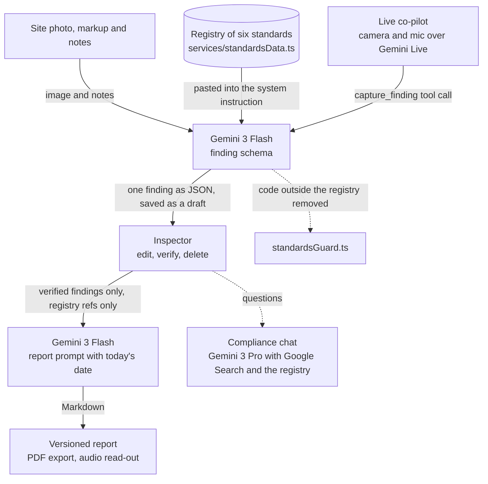

# SnapInspect AI

**Case study:** [sanaullahjannisar.com/work/snapinspect](https://sanaullahjannisar.com/work/snapinspect/), with the story, results and architecture. Built by [Sanaullah Jannisar](https://sanaullahjannisar.com), AI engineer.

SnapInspect turns a site photo into a drafted safety finding tied to a specific OSHA or ISO 45001 standard, then compiles verified findings into an inspection report. The model picks the standard from a fixed registry of six that travels with every call, and the code rejects any reference that is not on that list.

**Status:** a demo build that runs locally. There is no public deployment right now. Sign-in is simulated in the browser and findings live in the browser's local storage, so it is not ready for field use.

## Why a fixed registry

A general chatbot can describe a photo, but it will cite a rule that does not exist. An inspection report has to point to a real standard. An earlier version asked the model to find the exact OSHA code with Google Search. This version gives it a list instead: `services/standardsData.ts` holds six standards (29 CFR 1926.651, 1926.501, 1910.147, 1926.451, 1926.1053 and ISO 45001:2018), and the prompt requires the finding's reference to be an exact code from that list, with fixed answers for excavations (1926.651) and falls (1926.501). The price is coverage: a hazard outside those six has no correct citation to pick.

The prompt is backed by a check in code (`services/standardsGuard.ts`, covered by `npm test`):

- **Model output.** A reference that is not an exact registry code (a paragraph such as `(b)(1)` is allowed) is removed from the finding and shown only as an unverified suggestion. Linked standards are rebuilt from the registry, so titles and URLs never come from the model.
- **Typed references.** An inspector can still type any code. One outside the registry is saved but labelled "not in the certified registry" on the finding, and the report prompt gets "None from the certified registry" instead.
- **Reports.** Only supervisor-verified findings go into a report; the report page counts the drafts it left out. After generation, any regulation the report text names that is not in the registry is flagged on the page and before PDF export.
- **Library.** The Library page lists the same six standards.

## What it does

- **Photo to finding.** Upload a site photo, mark it up so the model looks where you point, and add notes. Gemini returns one finding as JSON held to a schema: title, category, priority, observation, recommended fix, the standard, and two separate confidence scores (what it saw, and the rule it chose). The scores are the model's own estimate, not measured accuracy.
- **Draft until verified.** Every AI finding is saved as `AI_DRAFT`. The inspector edits, verifies or deletes it, and moves it through `OPEN`, `IN_PROGRESS`, `MITIGATED` and `VERIFIED_CLOSED`. Only a supervisor or admin role can close a finding. Each change is appended to the finding's history.
- **Report.** Verified findings are compiled into a Markdown inspection report with the site name and today's date. The prompt tells the model to use only the facts given and write "Not recorded" for anything missing. Each generated report is saved as a new version, exports to PDF, and can be read aloud with Gemini text to speech.
- **Compliance chat.** A separate chat answers questions about the current site using Gemini with Google Search and the same registry.
- **Live co-pilot.** A camera and microphone session over the Gemini Live API. When you describe a hazard out loud, the model calls a `capture_finding` tool, which grabs a frame and runs it through the same photo to finding path.

## How it works



All model calls are in `services/geminiService.ts` (photo, chat, report, audio) and `components/LiveInspector.tsx` (live session). State is in `context/InspectionContext.tsx`. It is a React 19 and Vite single-page app with no backend.

## Run it locally

Prerequisites: Node.js 18 or later and a Gemini API key.

```bash
npm install
# create .env.local in the project root with one line:
#   GEMINI_API_KEY=<your key>
npm run dev
npm test        # registry and report checks (no API calls)
```

The dev server starts on port 3000. Sign-in is simulated in `services/authService.ts`: any email and password work, and the one-time code is shown on screen. Opening a site needs one of the demo site tokens hard-coded in `context/AuthContext.tsx`.

### The API key is exposed to the browser

`vite.config.ts` copies `GEMINI_API_KEY` into the client bundle as `process.env.API_KEY`, and every Gemini call is made from the browser. Anyone who opens the page can read the key from the JavaScript. Use it only for local demos with a key you can revoke, and do not deploy a build made with a real key. Before any shared deployment, the calls should move behind a small server proxy that holds the key and forwards requests.

## Known limits

- One photo produces one finding, even when it shows several hazards, and they are filed under one standard.
- Sign-in, site tokens, the home page telemetry bars and the report hash are placeholders.
- The PDF export prints the report's raw Markdown.
- The report citation check recognises CFR, ISO and ANSI codes only; it cannot tell whether the report describes a cited rule correctly.

## Stack

React 19, TypeScript, Vite, Tailwind (CDN), `@google/genai`, jsPDF, react-markdown, lucide-react.
